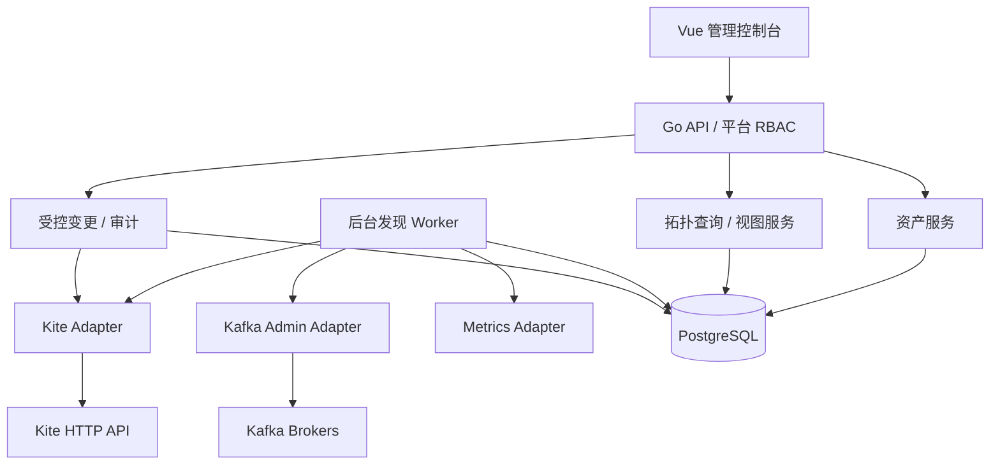

> 2026-10-23 当前产品调整：内网无登录的共享消息拓扑与信息记录平台。登录、权限、业务账号密码交付、ACL和基础设施写操作退出当前范围；历史条目仅用于理解旧实现，不覆盖当前要求。信息登记可写，Kafka/MM2只采集查询，连接秘密仍仅供后台使用。现行设计见 [信息平台方案](superpowers/specs/2026-10-23-topology-information-platform.md)。

# 技术架构

## 技术栈
- Backend：Go，HTTP framework 可选择 Gin；`franz-go/kadm` 实现 Kafka Admin；PostgreSQL；后台同步 Worker。
- Frontend：Vue 3 + TypeScript + Vite + Element Plus + AntV X6；拓扑图布局另存，与发现数据分离。
- Infra：Kite HTTP API 是 Kubernetes 的唯一接入面（读 + 写）；Kafka 使用 Kafka 协议独立连接；Prometheus/VM 以 HTTP 查询；LDAP 用独立 IdentityProvider。

## 分层

## 真相和置信度
- `declared`：ConfigMap 中出现的源/目标规则，以及 Deployment 的配置引用。
- `observed`：Kubernetes Deployment/Pod 的实际版本、状态、时间、UID；Kafka Topic 元数据实际可查询。
- `verified`：经同步数据、监控指标或人工确认的真正业务链路；多源写入的业务意图属人工确认。
- `stale`：距离最后一次成功采集过久；`unknown`：无权限、解析失败、API 不可达等。

## MM2 发现算法（必须可测试）
1. 对平台已登记的 Kite 集群调用 Namespace 列表；也允许显式允许的 Namespace 白名单。
2. 逐 Namespace 读取 Deployments、Pods、ConfigMaps。仅已确认 Kite 版本支持的路由。
3. 用 Deployment `volumes.configMap`、`env.valueFrom.configMapKeyRef`、`envFrom.configMapRef` 查找 ConfigMap 关联；考虑 Helm 风格命名及多个容器。
4. 在已关联 ConfigMap 的 data 中识别 Java Properties 格式或 YAML 内嵌的 MM2 配置；优先依据 `clusters`、`<source>-><target>.enabled`、`<source>-><target>.topics` 和镜像/启动参数组合判断，单独一个 `topics` 不能充分确证。
5. 保留原始 Topic 选择器表达式；可选从 Kafka 真实 Topic 列表计算“匹配主题集合”，不将正则数量直接当实际 Topic 数。
6. 建立逻辑链路与部署实体的关系；对缺失/歧义的 source、target、bootstrap、ConfigMap 关联，标记低置信度和人工待核实。
7. 按 Namespace、Deployment UID、ConfigMap UID/resourceVersion 写发现快照；Kite 查询失败不自动删除历史资产，而是打 stale。
8. 针对 moon-prod 双源写入叠加 Approved Architecture Note；对 `styx2saturn-res` 叠加人工确认“目标 saturn-uat”。

## 重要边界
- 配置已挂载/被 Deployment 引用 ≠ 当前 Pod 进程已成功加载。
- Kafka Broker 中的 `advertised.listeners` 不等于所有调用者可访问；每个运行环境的 bootstrap、TLS/SASL 单独管理。
- 未知 Kafka 集群不可能仅靠已有 Kafka AdminClient 自动全网发现；必须先从配置、人工注册或资产导入取得入口。
- 更改 ConfigMap 后需评估 MM2 启动模式和版本的重新加载机制；默认通过受控 Deployment rollout 生效，验证健康后完成操作。

## v2 追加：Kafka 集群连接控制面

Kafka Registry 是一级子系统，与 Kite Registry 同等级。Vue 通过 Backend 注册不同集群的 bootstrap + SASL/TLS；连接信息保存为非敏感字段 + SecretRef，不直接存明文密码，也不持久化原始 JAAS。Go Kafka Adapter 从 SecretStore 按需解析密码并建立隔离的客户端；对每个集群独立限制连接数和探测并发；依靠 Kafka Cluster ID 和人工确认绑定 MM2 别名。

主支持范围：Kafka 3.7 和 3.9.2；兼容性测试覆盖 3.6 与 2.8。Broker exact version 有可能未知，接口功能依实际结果/ApiVersions 检测，明确版本来源。

完整流程、领域模型、API、功能矩阵及验收见 `docs/KAFKA_CLUSTER_MANAGEMENT.md`。本文件以该章节作为 Kafka 部分的规范性补充。
