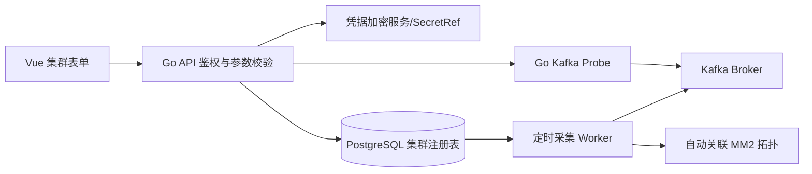

# LunaOrbit Kafka 集群连接与运维方案 v2

2026-10-21补充：用户批准的新方案见 `superpowers/specs/2026-10-21-kafka-management-v3-design.md`。新增账号采用SCRAM-SHA-256，应用资料与账号分离。原“密码不读回”继续适用于集群连接管理凭据和普通查询；业务账号托管密码按 SECURITY.md 的独立权限交付例外处理。Kafka发现的身份没有托管密码时只能显示未托管，录入需实际验证，不修改原密码或ACL。

## 1. 用户操作模型（参考提供的 Kafka 集群切换界面）

- 从左侧「Kafka / 集群管理」进入集群列表；支持新增、编辑、停用、连接测试、切换、删除（逻辑删除；需确认）、授权范围筛选。
- 新增集群表单分段：基础信息、连接端点、认证安全、验证结果；**不要在表格内回显密码或整份 JAAS**。
- 列表展示：显示名称、机房、环境、Broker 入口、连接状态、Cluster ID、能力摘要、最后探测时间、操作。
- 切换集群后右侧提供 Broker、Topic、分区、副本/ISR、Consumer Group、ACL、配置等菜单；切换只更新前端当前上下文，不改变其他用户会话。
- 用户也可选择所有已授权集群的汇总视图和与 MM2 相关联的拓扑。

## 2. 支持环境与协议

| 项目 | v1 范围 | 约束 |
|---|---|---|
| Kafka 服务端 | 主路径验证 3.7.x、3.9.2 | 不假定完全一致的 API/配置能力 |
| Kafka 3.6 / 2.8 | 尽可能查询元数据，逐项能力检测 | 老版本单独测试；功能禁用应解释原因 |
| KRaft / ZooKeeper | Admin API 层都能注册 | Broker 控制器和 ACL 功能需差异化 |
| bootstrap.servers | 多地址（逗号或换行） | 验证地址格式、网络允许列表和 DNS |
| security.protocol | PLAINTEXT、SSL、SASL_PLAINTEXT、SASL_SSL | 优先 SASL_SSL/SSL；不安全协议带警告 |
| sasl.mechanism | PLAIN、SCRAM-SHA-256、SCRAM-SHA-512 | Kerberos/OAUTHBEARER 后续按需支持 |
| TLS | CA、ServerName、客户端证书（按需） | 禁用证书验证不作为默认功能 |

Go franz-go 通过 `pkg/kgo`、`pkg/kadm`、`pkg/sasl/plain`、`pkg/sasl/scram` 和 `kgo.DialTLSConfig` 配置 Kafka 客户端。Java 的 `sasl.jaas.config` **不能直接传给 franz-go 解析或执行**，平台须映射成结构化 `username`、`password` 与对应 SASL mechanism。可以提供“导入 Kafka Java properties 文本”作为**本地表单解析辅助**，默认关闭；导入只接受严格白名单字段并显示脱敏预览，不能持久化原始 JAAS 字符串。

## 3. 集群注册数据流程



1. 表单输入连接参数，密码只能提交到后端 HTTPS API，**不经查询 API 回显**。
2. 测试连接首先验证 TCP / DNS 与 TLS，然后进行 SASL 握手，再调用可用的 Metadata/DescribeCluster/ApiVersions 类查询，记录结果和失败类别。
3. 首次注册可以在测试成功后保存，也允许因网络未开通而注册为 `unverified`，但必须明确显示未验证，禁止将其当作健康集群。
4. 从 Cluster ID 推断是否与已有集群相同；同一 Cluster ID 可有不同入口或多个凭据，不应盲目合并业务登记。未拿到 Cluster ID 时保留临时登记 ID。
5. Kafka 返回的 `advertised.listeners` 地址可能导致后续请求失败，因此不仅要测试 bootstrap，还要测试发现的可达 Broker。
6. Kafka 精确版本号不保证能够从 Kafka Admin 协议可靠取得：优先展示可信人工登记、JMX/exporter 或受控环境元数据来源，并附 `version_source`；功能启用以实际 API 支持情况为准。
7. 定期探测必须有并发限制、限速、超时、断路策略，不因为一条链路故障拖垮其他集群。

## 4. 数据模型（建议 SQL 表）

- `kafka_cluster_registrations`: id, display_name, room, environment, description, bootstrap_servers_json, enabled, discovered_cluster_id(nullable), version_reported(nullable), version_source, status, last_probe_at, last_probe_error_code, created_by, created_at, updated_at, deleted_at。
- `kafka_cluster_credentials`: id, cluster_registration_id, auth_mechanism, security_protocol, username_masked, secret_ref, tls_ca_ref, tls_cert_ref, tls_key_ref, tls_server_name, revision, changed_at。**不能存明文密码**。
- `kafka_cluster_capabilities`: cluster_registration_id, feature, supported, reason, probed_at（ACL_READ、ACL_WRITE、TOPIC_CREATE、TOPIC_ALTER_CONFIG、GROUP_LAG、DESCRIBE_QUORUM 等）。
- `kafka_brokers`, `kafka_topics`, `kafka_partitions`, `consumer_groups`, `consumer_group_offsets`：按集群 ID 分区记录，有 observed_at 和 stale 标记。
- `kafka_acl_audit`: id, request_id, cluster_registration_id, principal, resource_type, pattern_type, operation, permission, action, result, actor, timestamp。
- `mm2_cluster_alias_bindings`: id, kite_cluster_id, namespace, workload_uid, mm2_alias, bootstrap_normalized, kafka_registration_id(nullable), match_method, confidence, reviewed_by。

必要约束：平台资源范围绑定集群登记 ID；不允许仅按显示名称授权。删除集群应阻止仍被 MM2 或视图引用的物理数据级联删除。密码更新采用替换凭据 revision，旧凭据只在极短可控回滚窗口内保留。

## 5. Go 客户端接口

```go
type KafkaConnectionProfile struct {
    ClusterRegistrationID string
    BootstrapServers []string
    SecurityProtocol string // PLAINTEXT, SSL, SASL_PLAINTEXT, SASL_SSL
    SASLMechanism string    // PLAIN, SCRAM-SHA-256, SCRAM-SHA-512
    Username string
    PasswordSecretRef string
    TLSCASecretRef string
    TLSServerName string
}

type KafkaAdminGateway interface {
    Probe(ctx context.Context, clusterID string) (ProbeResult, error)
    DescribeCluster(ctx context.Context, clusterID string) (ClusterSnapshot, error)
    ListTopics(ctx context.Context, clusterID string) ([]TopicSnapshot, error)
    ListConsumerGroups(ctx context.Context, clusterID string) ([]ConsumerGroupSnapshot, error)
    ListACLs(ctx context.Context, clusterID string, filter ACLFilter) ([]ACLRule, error)
}
```

接口输入使用登记 ID；密钥解析只发生在服务端。为不同注册集群创建独立客户端，不共享 SASL 配置。连接池须有资源上限、空闲清理、凭据更新后的连接失效机制。所有入口地址必须受 egress 策略和服务端 allowlist 管控，防止用户借平台访问任意内网目标。

## 6. 平台 API（**这是 LunaOrbit 自己要实现的 API，不是 Kafka 或 Kite 已存在的 URL**）

| Method | Path | 用途 | 默认权限 |
|---|---|---|---|
| GET | /api/v1/kafka/clusters | 列出当前用户可访问的集群 | viewer |
| POST | /api/v1/kafka/clusters | 新增注册；支持未验证状态 | admin |
| PATCH | /api/v1/kafka/clusters/:id | 更新描述及非敏感字段 | admin |
| PUT | /api/v1/kafka/clusters/:id/credentials | 替换凭据，禁止读回 | admin |
| POST | /api/v1/kafka/clusters/:id/probe | 启动受限连接探测任务 | operator |
| GET | /api/v1/kafka/clusters/:id/brokers | 实时/缓存 Broker 视图 | viewer |
| GET | /api/v1/kafka/clusters/:id/topics | 分页 Topic 视图 | viewer |
| GET | /api/v1/kafka/clusters/:id/groups | Consumer Groups | viewer |
| GET | /api/v1/kafka/clusters/:id/acls | ACL 查询 | security-admin |
| POST | /api/v1/kafka/clusters/:id/acl-requests | 提交 ACL 变更申请，非直接执行 | security-admin |

对于网络不可达、认证失败、无权限、API 不支持、请求超时必须返回不同错误码。写操作不能从前端直接绕过审批流程。

## 7. 与 MM2 自动发现对接

- 从 Kite 的 ConfigMap 获取 MM2 的 `clusters`、`alias.bootstrap.servers`、`source->target.topics` 等字段，关联 Deployment/Pod。
- 解析出的 MM2 地址与 `kafka_cluster_registrations` 的 bootstrap 地址进行规范化候选匹配；**最终优先使用实际 Kafka Cluster ID 确认**。
- 地址候选可能是内外网不同 listener、域名或 NodePort；匹配失败时用人工绑定并保留证据/置信度，不要自动创建多个“已验证” Kafka 集群。
- 不从 ConfigMap 中的凭据字段自动导入账号密码，必须遮蔽敏感值，MM2 数据源以已授权的只读采集为准。
- 当前业务事实：mars 与 charon 是**批准的双源写入**，不是异常；styx2saturn-res 的实际目标 saturn-uat；moon-prod Topic RF 须现场核验。

## 8. 安全和测试验收

- 安全：不展示密码、不在响应中返回 JAAS；凭据字段写入专用 SecretStore（KMS/Vault/密文+独立主密钥），TLS 通道优先，密钥轮换、最小权限和审计。
- 集群探测：最少涵盖 SASL/PLAIN、SCRAM-256、SCRAM-512、SSL 以及失败回退与超时；正确区分 `AuthenticationFailed`、`TLSHandshakeFailed`、`BrokerUnreachable`、`AuthorizationDenied`。
- 跨版本：Kafka 3.7.x 与 3.9.2 做集成测试；3.6/2.8 做兼容测试。测试环境可以先用容器 Mock/真实非生产 Kafka。
- 交互：新增 -> 测试 -> 保存 -> 切换 -> 浏览 Topic -> 查询 ACL 成功；没有真实 Kafka 环境时必须用 Mock 状态和测试环境模拟，不得伪造生产成功。
- ACL：只有 Broker 已启用正确授权器且当前管理主体有权限，才能允许查询/变更。LDAP 账号身份与 Kafka Principal 独立管理。

## 9. 官方依据

- franz-go： https://github.com/twmb/franz-go
- Kafka 3.9 安全概览： https://kafka.apache.org/39/security/security-overview/
- Kafka SASL： https://kafka.apache.org/43/security/authentication-using-sasl/
- Kite 认证： https://kitehq.dev/zh/api/authentication
- Kite 资源 API： https://kitehq.dev/zh/api/resources
